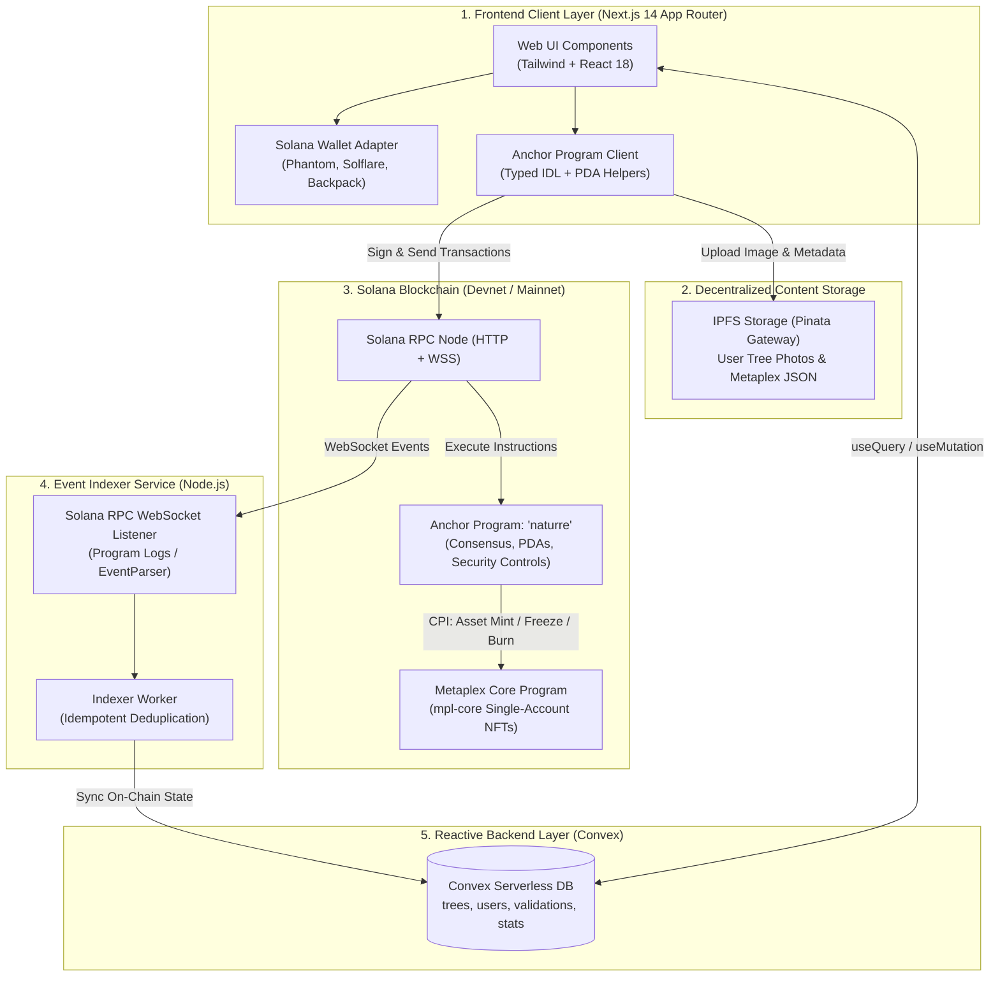
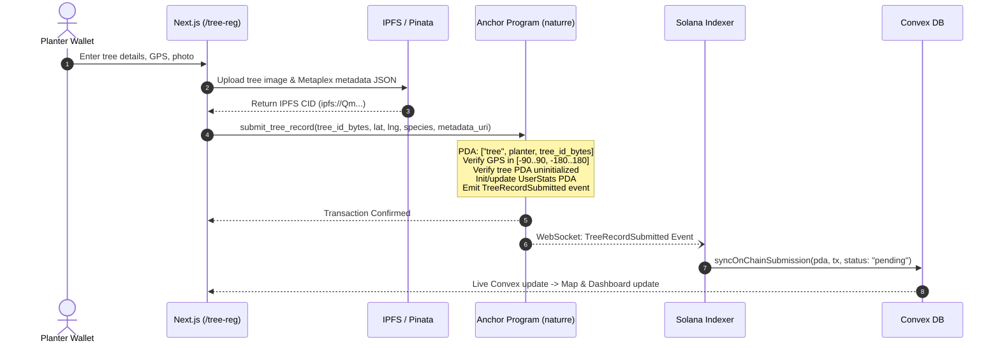
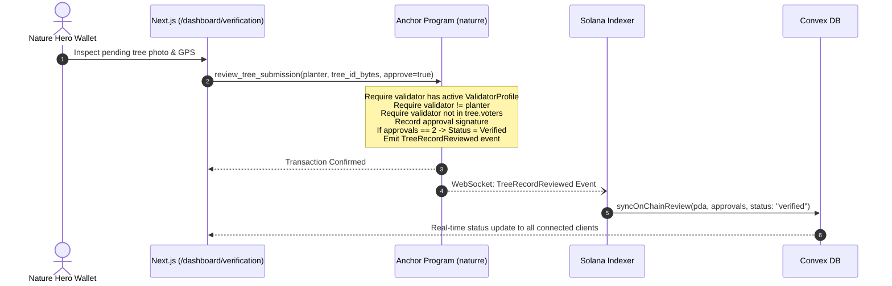
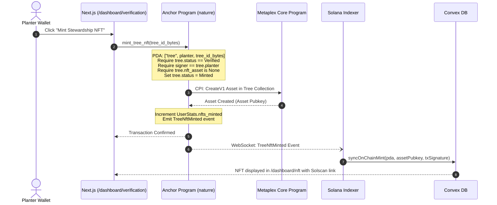
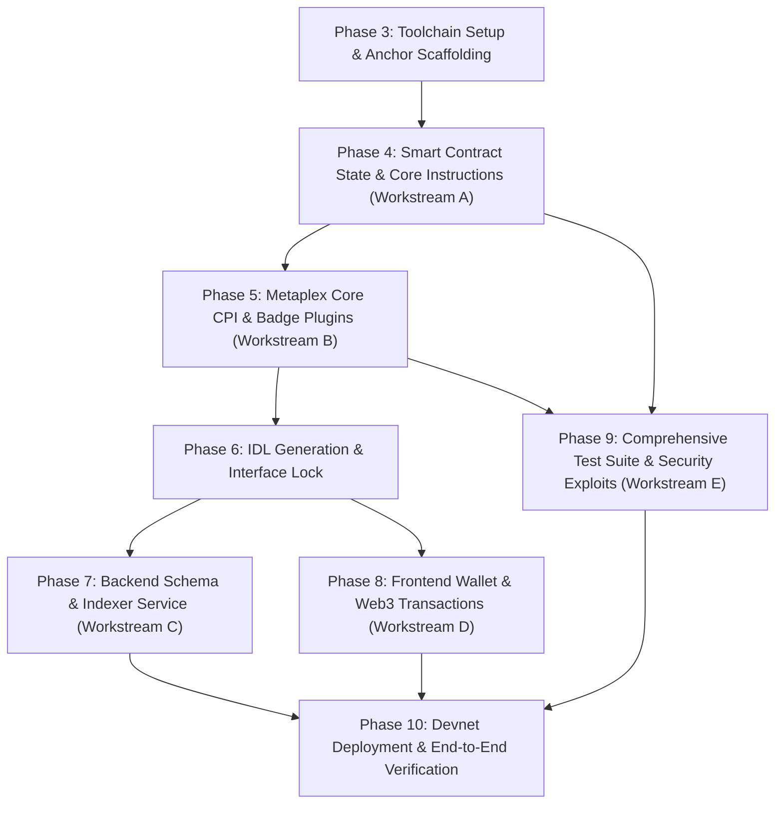

# CNC DAO (Naturre) — Smart Contract, Web3 & Full-Stack Architecture Specification

> **Document Status:** Authoritative Single Source of Truth  
> **Primary Specification:** Aligned directly with the CNC DAO (Naturre) Smart Contract & Web3 Architecture PRD  
> **Target Branch:** `feature/naturre-smart-contract`  
> **Protocol Target:** Solana Devnet (Staging) & Mainnet-Beta (Production)  
> **Frameworks:** Anchor (Solana), Metaplex Core (`mpl-core`), Next.js 14 App Router, Convex Reactive DB

---

## Table of Contents

1. [Executive Summary & System Topology](#1-executive-summary--system-topology)
2. [Architectural Separation of Concerns](#2-architectural-separation-of-concerns)
3. [Engineering Responsibilities vs Creative Assets (NFT Artwork Rules)](#3-engineering-responsibilities-vs-creative-assets-nft-artwork-rules)
4. [Testing-First Development Policy](#4-testing-first-development-policy)
5. [Anchor Smart Contract Specification (PRD-Aligned)](#5-anchor-smart-contract-specification-prd-aligned)
6. [Metaplex Core & Digital Asset Specification](#6-metaplex-core--digital-asset-specification)
7. [Frontend Web3 Integration Specification](#7-frontend-web3-integration-specification)
8. [Convex Backend Integration Specification](#8-convex-backend-integration-specification)
9. [Blockchain Event Indexer Specification](#9-blockchain-event-indexer-specification)
10. [Testing & Security Verification Strategy](#10-testing--security-verification-strategy)
11. [Agent Workstream Organization & File Ownership](#11-agent-workstream-organization--file-ownership)
12. [Implementation Roadmap & Dependency Graph](#12-implementation-roadmap--dependency-graph)
13. [Technical Uncertainties & Decisions Pending Project-Owner Approval](#13-technical-uncertainties--decisions-pending-project-owner-approval)

---

## 1. Executive Summary & System Topology

CNC DAO (Naturre) is a decentralized Regenerative Finance (ReFi) platform that connects real-world community tree planting with cryptographic proofs of stewardship on the Solana blockchain. 

In strict alignment with the PRD:
- **Planters** plant trees, record GPS coordinates and photos, and submit tree planting records.
- **Nature Heroes** (peer validators approved by the core team) independently audit and verify submissions.
- **Verification Consensus:** A tree must achieve **2-of-N independent Nature Hero approvals** before it transitions to `Verified`.
- **Proof-of-Stewardship Tree NFTs:** One freely transferable Metaplex Core digital asset per verified tree, minted to the original planter.
- **Planter Milestone Badges:** Transferable collectible badges awarded at verifiable planting thresholds (**First Root** at 1 tree, **Grove Builder** at 10 trees, **Forest Guardian** at 50 trees).
- **Nature Hero Badges:** Non-transferable (soulbound), core-team-approved, and revocable credential badges.
- **Self-Custodial Wallet Identity:** Users sign all blockchain transactions directly using their connected Solana wallets (Phantom, Solflare, Backpack).
- **Transaction Fees & Account Rent:** The connected user acts as the default payer for their on-chain account rent and transaction fees.

### 1.1 End-to-End System Topology



### 1.2 Core Operational Sequences

#### A. Planter Tree Registration Flow


#### B. Nature Hero Review & Consensus Flow (2-of-N Independent Approvals)


#### C. Proof-of-Stewardship Metaplex Core NFT Mint Flow


---

## 2. Architectural Separation of Concerns

| Domain | Client Frontend | Convex Backend | Solana Smart Contract | IPFS Storage |
| :--- | :---: | :---: | :---: | :---: |
| **User Identity & Profiles** | Render UI | Authoritative DB | Wallet pubkey only | Avatar storage |
| **Botanical Notes & Photos** | Client capture | CDN thumbnail cache | Not Stored | Authoritative Asset |
| **GPS Coordinates** | Form validation | Read query cache | Authoritative On-chain | Encoded in JSON |
| **Validator Eligibility** | Gated UI views | Audit log cache | Authoritative PDA | Not Stored |
| **Verification Consensus** | Display status | Read query mirror | Cryptographic Gate (2-of-N) | Not Stored |
| **NFT Asset Ownership** | Gallery view | Cached index | Authoritative On-chain | Metadata target |
| **Badge Revocation** | Admin UI trigger | Audit log | Authoritative Burn CPI | Not Stored |
| **GIS Map Rendering** | Leaflet rendering | Low-latency API | Not queried directly | Not Stored |

**Core Rule:** Client-side role gating and Convex database records are for user experience and fast indexing only. All critical business rules (consensus, minting rights, anti-self-validation, emergency pause) are strictly enforced by the Solana Anchor program.

---

## 3. Engineering Responsibilities vs Creative Assets (NFT Artwork Rules)

Our engineering scope does **NOT** include designing, generating, or producing creative NFT artwork:
- **Tree NFT artwork** (certificates, illustrations, generative layers) will be provided by the creative/design team.
- **Planter milestone badge artwork** (First Root, Grove Builder, Forest Guardian) will be provided by the creative/design team.
- **Nature Hero credential badge artwork** will be provided by the creative/design team.

### Engineering Responsibilities:
1. Implement the metadata schemas adhering strictly to the Metaplex Core standard.
2. Support uploading supplied creative assets and JSON metadata to IPFS via Pinata.
3. Configure the on-chain metadata URIs (`ipfs://Qm...`).
4. Integrate Metaplex Core minting via CPI.
5. Verify that wallets (Phantom, Solflare, Backpack) and the Next.js frontend retrieve and display the metadata and images.
6. **Devnet Testing Assets:** If official artwork is not yet available during development, engineering will use clearly identified **temporary test placeholder assets** on Devnet. Placeholder assets will never be presented as final production assets.
7. **User-Submitted Tree Photographs:** Unlike collection artwork, photographs submitted by community planters are real field data captured during tree planting; the engineering stack must support photo resizing, IPFS upload, and linking to the on-chain tree record.

---

## 4. Testing-First Development Policy

To maintain protocol security and eliminate regressions, implementation must strictly follow this phased, testing-first sequence:

1. **Toolchain Verification:** Verify Rust, Solana CLI, Anchor CLI, and Node dependencies.
2. **Anchor Workspace Scaffolding:** Initialize clean Anchor program workspace with shared configuration.
3. **Incremental Staged Implementation:** Implement state structures, PDA derivations, and individual instructions in small, independently testable stages.
4. **Instruction & Security Restriction Testing:** Write comprehensive unit and integration tests for every instruction before moving to the next (including coordinate bounding, unauthorized admin checks, self-validation blocks, duplicate voting blocks).
5. **Metaplex Core CPI Verification:** Test minting, ownership assignment, transferability, soulbound freezing, and revocation burning.
6. **Integration Testing:** Test frontend wallet dispatchers and backend indexing synchronization against the local validator / Devnet.
7. **Complete Devnet End-to-End Verification:** Execute the full lifecycle (Planter submission -> 2 Nature Hero reviews -> Metaplex Core minting) on Solana Devnet.
8. **Issue Resolution:** Resolve all critical findings before considering production.
9. **Strict Guardrail:** **Never deploy to Mainnet during development.**

---

## 5. Anchor Smart Contract Specification (PRD-Aligned)

### 5.1 Module Organization

```
programs/naturre/src/
├── lib.rs                  # Program entrypoint & instruction dispatchers
├── constants.rs            # Canonical seeds, version codes, numeric bounds
├── errors.rs               # Strongly typed custom error codes
├── events.rs               # On-chain event definitions emitted for indexing
├── state/                  # Account state schemas with space calculations
│   ├── mod.rs
│   ├── protocol_config.rs  # ProtocolConfig account
│   ├── validator_profile.rs# ValidatorProfile account
│   ├── tree_record.rs      # TreeRecord account (PRD seeds: ["tree", planter, tree_id_bytes])
│   └── user_stats.rs       # UserStats account
├── instructions/           # Instruction contexts and handlers
│   ├── mod.rs
│   ├── initialize_protocol.rs
│   ├── approve_validator.rs
│   ├── revoke_validator.rs
│   ├── submit_tree_record.rs
│   ├── review_tree_submission.rs
│   ├── mint_tree_nft.rs
│   ├── claim_milestone_badge.rs
│   ├── issue_validator_badge.rs
│   └── toggle_pause.rs
└── metaplex/               # Metaplex Core CPI helpers & plugin configs
    ├── mod.rs
    ├── core_cpi.rs         # invoke_signed CPI wrappers
    └── plugins.rs          # PermanentFreeze & PermanentBurn plugin definitions
```

### 5.2 Canonical PDA Seeds (PRD Formulation)

| Account | Canonical Seed Formulation (PRD) | Bump Storage | Authority |
| :--- | :--- | :--- | :--- |
| **ProtocolConfig** | `[b"config"]` | `bump: u8` | `admin_authority` |
| **ValidatorProfile**| `[b"validator", validator_pubkey.as_ref()]` | `bump: u8` | `admin_authority` / `validator` |
| **TreeRecord** | `[b"tree", planter_pubkey.as_ref(), tree_id_bytes.as_ref()]` | `bump: u8` | `planter` / Program PDA |
| **VoteRecord** | `[b"vote", tree_record_pda.as_ref(), validator_pubkey.as_ref()]` | `bump: u8` | `validator` / Program PDA |
| **UserStats** | `[b"user_stats", user_pubkey.as_ref()]` | `bump: u8` | `user_pubkey` / Program PDA |
| **Tree Collection** | `[b"tree_collection"]` | `bump: u8` | Program PDA |
| **Badge Collection**| `[b"badge_collection"]` | `bump: u8` | Program PDA |

*PRD Tree Seed Alignment:*  
The PRD explicitly defines the seed for tree records as:
```rust
seeds = [b"tree", planter.key().as_ref(), tree_id_bytes.as_ref()]
```
- `tree_id_bytes` is a unique 32-byte identifier (`[u8; 32]`) generated during submission (e.g. SHA-256 hash of submission metadata or unique UUID bytes).
- Scoping the seed by `planter` provides strong domain separation per planter wallet.
- For validators to locate and review a tree, the client supplies both `planter` and `tree_id_bytes` (which are indexed off-chain in Convex and emitted in on-chain events).

### 5.3 Account Schemas & Exact Space Allocations

#### 1. ProtocolConfig
- **Seed:** `[b"config"]`
- **Space Calculation:** 
  `8 (discriminator) + 32 (admin) + 32 (treasury) + 1 (required_approvals) + 1 (paused) + 8 (fee_lamports) + 33 (tree_col) + 33 (badge_col) + 8 (init_at) + 8 (updated_at) + 1 (bump) + 64 (padding) + 32 = 293 bytes` (allocated: **293 bytes**)
- **Fee Type:** `protocol_fee_lamports: u64` (8 bytes, adequately supporting lamport-denominated values).

```rust
#[account]
#[derive(Default)]
pub struct ProtocolConfig {
    pub admin_authority: Pubkey,       // 32 bytes: Admin master key / Multisig
    pub fee_treasury: Pubkey,          // 32 bytes: Protocol treasury for fee sweeps
    pub tree_collection: Pubkey,       // 32 bytes: Metaplex Core Tree Collection asset
    pub badge_collection: Pubkey,      // 32 bytes: Metaplex Core Badge Collection asset
    pub is_paused: bool,               // 1 byte: Emergency circuit breaker
    pub protocol_fee_lamports: u64,    // 8 bytes: Protocol fee in lamports
    pub bump: u8,                      // 1 byte: Canonical bump
    pub padding: [u8; 64],             // 64 bytes: Reserved future expansion
}
```

#### 2. ValidatorProfile
- **Seed:** `[b"validator", validator_pubkey.as_ref()]`
- **Space Calculation:** 
  `8 + 32 + 1 + 8 + 4 + 4 + 4 + 8 + 1 + 32 = 102 bytes` (padded to **128 bytes**)

```rust
#[account]
#[derive(Default)]
pub struct ValidatorProfile {
    pub validator: Pubkey,             // 32 bytes: Validator wallet address
    pub is_active: bool,               // 1 byte: Active status flag (revocation toggle)
    pub approved_at: i64,              // 8 bytes: Accreditation timestamp
    pub total_reviewed: u32,           // 4 bytes: Total submissions inspected
    pub total_approved: u32,           // 4 bytes: Total submissions approved
    pub total_rejected: u32,           // 4 bytes: Total submissions rejected
    pub last_reviewed_at: i64,         // 8 bytes: Timestamp of latest review
    pub bump: u8,                      // 1 byte: Canonical bump
    pub padding: [u8; 32],             // 32 bytes: Reserved space
}
```

#### 3. TreeRecord (PRD-Aligned)
- **Seed:** `[b"tree", planter_pubkey.as_ref(), tree_id_bytes.as_ref()]`
- **Space Calculation:** 
  `8 + 32 + 32 + 8 + 8 + 32 + 4 + 100 + 1 + 33 + 33 + 33 + 1 + 1 + 8 + 9 + 33 + 1 + 64 = 447 bytes` (padded to **480 bytes**)

```rust
#[derive(AnchorSerialize, AnchorDeserialize, Clone, Copy, PartialEq, Eq, Default)]
pub enum TreeStatus {
    #[default]
    Pending,     // Submitted, awaiting 2-of-N validator quorum
    Verified,    // Approved by 2 independent Nature Heroes
    Rejected,    // Rejected by Nature Heroes
    Minted,      // Metaplex Core NFT minted to planter
}

#[account]
pub struct TreeRecord {
    pub tree_id_bytes: [u8; 32],       // 32 bytes: Content-addressed tree identifier
    pub planter: Pubkey,               // 32 bytes: Planter wallet address
    pub latitude: i64,                 // 8 bytes: Micro-degrees (degrees * 1_000_000)
    pub longitude: i64,                // 8 bytes: Micro-degrees (degrees * 1_000_000)
    pub species: [u8; 32],             // 32 bytes: Fixed-size UTF-8 byte array
    pub metadata_uri: String,          // 4 + 100 bytes: IPFS metadata URI ("ipfs://Qm...")
    pub status: TreeStatus,            // 1 byte: Status enum
    pub validator_1: Option<Pubkey>,   // 33 bytes: First validator to vote
    pub validator_2: Option<Pubkey>,   // 33 bytes: Second validator to vote
    pub validator_3: Option<Pubkey>,   // 33 bytes: Third validator (tie-breaker slot if 1-1 split)
    pub approvals_count: u8,           // 1 byte: Total approval votes (max 2)
    pub rejections_count: u8,          // 1 byte: Total rejection votes (max 2)
    pub submitted_at: i64,             // 8 bytes: Submission timestamp
    pub verified_at: Option<i64>,      // 9 bytes: Verification timestamp
    pub nft_asset: Option<Pubkey>,     // 33 bytes: Minted Metaplex Core asset address
    pub bump: u8,                      // 1 byte: Canonical bump
    pub padding: [u8; 64],             // 64 bytes: Reserved space
}
```

#### 4. UserStats
- **Seed:** `[b"user_stats", user_pubkey.as_ref()]`
- **Space Calculation:** 
  `8 + 32 + 4 + 4 + 4 + 1 + 8 + 1 + 32 = 94 bytes` (padded to **128 bytes**)

```rust
#[account]
#[derive(Default)]
pub struct UserStats {
    pub user: Pubkey,                  // 32 bytes: User wallet address
    pub trees_planted: u32,            // 4 bytes: Total submissions
    pub trees_verified: u32,           // 4 bytes: Total trees reaching Verified
    pub nfts_minted: u32,              // 4 bytes: Total Tree NFTs minted
    pub claimed_milestones: u8,        // 1 byte: Bitmask for claimed PRD badges (Bit 0: First Root, Bit 1: Grove Builder, Bit 2: Forest Guardian)
    pub first_planted_at: i64,         // 8 bytes: First submission timestamp
    pub bump: u8,                      // 1 byte: Canonical bump
    pub padding: [u8; 32],             // 32 bytes: Reserved space
}
```

### 5.4 Instructions & Consensus Enforcement

1. **`initialize_protocol(admin_authority, protocol_fee_lamports)`:** Initializes `ProtocolConfig` PDA.
2. **`initialize_tree_collection(name, uri)`:** Admin initializes the official Metaplex Core Tree Collection asset; sets its update authority to `protocol_config` PDA so that verified tree planters can trustlessly mint into the collection via CPI `invoke_signed`.
3. **`approve_validator(validator_pubkey)`:** Admin approves a Nature Hero, creating or reactivating `ValidatorProfile`, optionally issuing a soulbound credential badge via Metaplex Core CPI.
4. **`revoke_validator(validator_pubkey)`:** Admin revokes a validator, setting `is_active = false` and burning their credential badge via Metaplex Core `BurnV1` CPI.
5. **`submit_tree_record(tree_id_bytes, latitude, longitude, species, metadata_uri)`:**
   - PDA: `[b"tree", planter.key().as_ref(), tree_id_bytes.as_ref()]`.
   - Validates latitude in `[-90M..90M]`, longitude in `[-180M..180M]`, and metadata URI length.
   - Initial status: `TreeStatus::Pending`.
   - User signs and pays account rent.
6. **`review_tree_submission(planter, tree_id_bytes, decision: bool)`:**
   - 2-of-N consensus enforcement:
     - Signer must have active `ValidatorProfile`.
     - `validator != planter` (anti-self-validation).
     - Validator cannot vote twice on the same tree.
     - If `decision == true`: `approvals_count += 1`.
     - If `decision == false`: `rejections_count += 1`.
     - When `approvals_count == 2`: transitions to `TreeStatus::Verified`.
     - When `rejections_count == 2`: transitions to `TreeStatus::Rejected`.
     - In a 1-to-1 split (1 approval, 1 rejection): remains `Pending` until a 3rd validator votes.
7. **`mint_tree_nft(tree_id_bytes)`:**
   - Can only be called after tree reaches `TreeStatus::Verified`.
   - Signer must be the original `planter`.
   - Mints one transferable Metaplex Core asset in `tree_collection`.
   - Sets status to `TreeStatus::Minted`.
8. **`initialize_milestone_collection(name, uri)`:** Admin initializes the official Metaplex Core Milestone Badge Collection; sets its update authority to `protocol_config` PDA so that eligible users can permissionlessly mint milestone badges via CPI `invoke_signed`.
9. **`claim_milestone_badge(milestone_tier: u8)` (PRD Badges):**
   - Tier 0: **First Root** (Requires 1 verified tree)
   - Tier 1: **Grove Builder** (Requires 10 verified trees)
   - Tier 2: **Forest Guardian** (Requires 50 verified trees)
   - Verifies verified tree count, checks bitmask, mints transferable collectible via Metaplex Core CPI into `badge_collection`.
   - Sets corresponding bit in `user_stats.claimed_milestones` only upon successful mint.
10. **`toggle_pause()`:** Admin toggles emergency pause circuit breaker.

---

## 6. Metaplex Core & Digital Asset Specification

### 6.1 Asset Types & PRD Specifications

| Asset Type | Holder | Transferability | Metaplex Core Plugins | Authority Configuration |
| :--- | :--- | :---: | :--- | :--- |
| **Proof-of-Stewardship Tree NFT** | Planter Wallet | **Transferable** | `Attributes` (Species, Coords, Planting Date) | Owner |
| **First Root Milestone Badge** | Planter Wallet | **Transferable** | `Attributes` (Milestone Tier: 1 Tree) | Owner |
| **Grove Builder Milestone Badge** | Planter Wallet | **Transferable** | `Attributes` (Milestone Tier: 10 Trees) | Owner |
| **Forest Guardian Milestone Badge**| Planter Wallet | **Transferable** | `Attributes` (Milestone Tier: 50 Trees) | Owner |
| **Nature Hero Credential Badge** | Validator Wallet | **NON-TRANSFERABLE (Soulbound)** | 1. `PermanentFreezeDelegate`<br/>2. `PermanentBurnDelegate` | Freeze: `protocol_config_pda`<br/>Burn: `admin_authority` |

### 6.2 Soulbound Freezing & Administrative Revocation

1. **Soulbound Protection (`PermanentFreezeDelegate`):**
   - The asset is created with `frozen = true` and `PermanentFreezeDelegate` assigned to the `protocol_config` PDA.
   - Any attempt by the validator to transfer the asset via `TransferV1` is rejected at the Metaplex Core program level.
2. **Revocation (`PermanentBurnDelegate`):**
   - The asset is created with `PermanentBurnDelegate` assigned to the protocol admin.
   - When the core team revokes a validator, the program executes a CPI `BurnV1` instruction. Metaplex Core allows the designated burn delegate to burn the asset even while it is frozen.

---

## 7. Frontend Web3 Integration Specification

### 7.1 Wallet Identity & Fee Payer
- Users connect self-custodial Solana wallets (Phantom, Solflare, Backpack).
- The connected user is the default fee payer for account rent and network fees.
- `providers/SolanaProvider.tsx` is mounted client-side in `app/layout.tsx` with dynamic SSR suppression (`{ ssr: false }`).
- Wallet connection is an explicit user action; `components/WalletRedirect.tsx` is restricted to `/connect-wallet` to avoid redirect loops.

### 7.2 Tree Registration Integration (`app/tree-reg/page.tsx`)
1. User enters tree details, species, coordinates, and photo.
2. Form uploads photo to IPFS -> gets `imageUri`.
3. Form builds Metaplex metadata JSON and uploads to IPFS -> gets `metadataUri`.
4. User signs `submit_tree_record(tree_id_bytes, lat, lng, species, metadata_uri)` via wallet.
5. Frontend syncs transaction signature and PDA address to Convex.

### 7.3 Verification Queue Integration (`app/dashboard/verification/page.tsx`)
1. Nature Hero inspects pending submissions.
2. Clicking "Approve" prompts wallet signature for `review_tree_submission(planter, tree_id_bytes, true)`.
3. Clicking "Mint NFT" (for verified trees owned by the connected planter) prompts wallet signature for `mint_tree_nft(tree_id_bytes)`.

### 7.4 NFT Gallery (`app/dashboard/nft/page.tsx`)
- Displays real on-chain Metaplex Core assets owned by the user.
- Direct links to Solscan Devnet / SolanaFM.

---

## 8. Convex Backend Integration Specification

### 8.1 Schema Extensions (`convex/schema.ts`)
Convex maintains cached mirrors of on-chain state:
- `treeIdBytesHex`: string
- `onChainPda`: string
- `submissionTx`: string
- `nftAssetAddress`: string
- `mintTx`: string
- `approvalsCount`: number
- `verifiedAt`: string

### 8.2 Role Alignment
Harmonizes `convex/validators.ts` to check `"nature_hero"`, matching `convex/schema.ts`.

---

## 9. Blockchain Event Indexer Specification

Autonomous Node.js worker in `server/indexer/`:
- Listens to Solana RPC WebSocket (`connection.onLogs`).
- Decodes Anchor events (`TreeRecordSubmitted`, `TreeRecordReviewed`, `TreeNftMinted`, `ValidatorApproved`, `ValidatorRevoked`, `MilestoneBadgeClaimed`).
- Idempotently updates Convex records.
- Implements exponential backoff reconnection and historical catch-up reconciliation via `getSignaturesForAddress`.

---

## 10. Testing & Security Verification Strategy

### 10.1 Anchor Test Matrix (19 Scenarios)
- **TC-01:** Protocol initialization and collection setup.
- **TC-02:** Validator approval by admin; rejection of unauthorized approval calls.
- **TC-03 & TC-04:** GPS boundary validation (latitude in `[-90..90]`, longitude in `[-180..180]`).
- **TC-05 & TC-06:** 2-of-N consensus quorum (1st approval = Pending; 2nd independent approval = Verified).
- **TC-07:** Rejection quorum (2 rejections = Rejected).
- **TC-08:** Anti-self-validation: planter cannot validate their own tree.
- **TC-09:** Anti-duplicate vote: validator cannot vote twice on the same tree.
- **TC-10:** Unauthorized validator check: inactive validator cannot submit reviews.
- **TC-11 to TC-14:** Tree NFT minting checks: only verified trees, only planter, no double minting.
- **TC-15:** Soulbound enforcement: Nature Hero badge transfer blocked by Metaplex Core.
- **TC-16:** Revocation burn: admin successfully burns frozen Nature Hero badge.
- **TC-17 & TC-18:** PRD Milestone badge claims: First Root (1), Grove Builder (10), Forest Guardian (50).
- **TC-19:** Emergency pause circuit breaker blocks state-changing instructions.

---

## 11. Agent Workstream Organization & File Ownership

| Workstream | Name & Role | Primary Responsibility | Key Deliverables |
| :--- | :--- | :--- | :--- |
| **WORKSTREAM A** | **Anchor Smart Contract**<br/>*(Core Smart Contract Engineer)* | Account states, canonical PDAs, instruction logic, custom errors, consensus voting, pause circuit breaker. | Working Anchor program, generated IDL (`target/idl/naturre.json`), Rust unit tests. |
| **WORKSTREAM B** | **Metaplex Core & NFT**<br/>*(Metaplex CPI Specialist)* | Single-account Metaplex Core CPI integration, Tree & Badge Collections, `PermanentFreezeDelegate`, `PermanentBurnDelegate`. | CPI wrappers, transferable Tree NFTs, soulbound Nature Hero badges, revocation burn logic. |
| **WORKSTREAM C** | **Convex & Blockchain Indexer**<br/>*(Full-Stack Backend Engineer)* | Schema extensions, WebSocket log listener, EventParser reconciliation loop, secure backend admin signing route. | Extended Convex schema, autonomous indexer worker (`server/indexer/`), admin API endpoint. |
| **WORKSTREAM D** | **Next.js Frontend Integration**<br/>*(Full-Stack Web3 Engineer)* | Wallet adapter restoration, Pinata IPFS client, Anchor transaction dispatchers, live NFT gallery and verification table. | Non-looping wallet connection, form-to-chain tree submissions, validator voting buttons, live on-chain NFT cards. |
| **WORKSTREAM E** | **Testing, Security & Devnet**<br/>*(Security Auditor & QA Lead)* | Mocha/Chai integration test suite, exploit simulations (self-validation, double vote), Devnet deployment and verification. | 100% test pass rate across 19 scenarios, verified Devnet program deployment, IDL on-chain initialization. |

### File Ownership Matrix

| Directory / File Path | Workstream A | Workstream B | Workstream C | Workstream D | Workstream E |
| :--- | :---: | :---: | :---: | :---: | :---: |
| `programs/naturre/src/lib.rs` | **OWNER** | Contributor | Read Only | Read Only | Read Only |
| `programs/naturre/src/state/**` | **OWNER** | Read Only | Read Only | Read Only | Read Only |
| `programs/naturre/src/instructions/submit_tree_record.rs` | **OWNER** | Read Only | Read Only | Read Only | Read Only |
| `programs/naturre/src/instructions/review_tree_submission.rs` | **OWNER** | Read Only | Read Only | Read Only | Read Only |
| `programs/naturre/src/metaplex/**` | Read Only | **OWNER** | Read Only | Read Only | Read Only |
| `programs/naturre/src/instructions/mint_tree_nft.rs` | Contributor | **OWNER** | Read Only | Read Only | Read Only |
| `programs/naturre/src/instructions/issue_validator_badge.rs` | Contributor | **OWNER** | Read Only | Read Only | Read Only |
| `convex/schema.ts` | Read Only | Read Only | **OWNER** | Read Only | Read Only |
| `server/indexer/**` | Read Only | Read Only | **OWNER** | Read Only | Read Only |
| `lib/solana/**` & `lib/ipfs/**` | Read Only | Read Only | Read Only | **OWNER** | Read Only |
| `providers/SolanaProvider.tsx` | Read Only | Read Only | Read Only | **OWNER** | Read Only |
| `app/tree-reg/page.tsx` | Read Only | Read Only | Read Only | **OWNER** | Read Only |
| `app/dashboard/verification/page.tsx` | Read Only | Read Only | Read Only | **OWNER** | Read Only |
| `app/dashboard/nft/page.tsx` | Read Only | Read Only | Read Only | **OWNER** | Read Only |
| `tests/anchor/**` | Read Only | Read Only | Read Only | Read Only | **OWNER** |
| `scripts/deploy-devnet.sh` | Read Only | Read Only | Read Only | Read Only | **OWNER** |

---

## 12. Implementation Roadmap & Dependency Graph



1. **Phase 3:** Toolchain verification (Rust, Solana CLI, Anchor CLI, npm deps, Anchor workspace scaffolding).
2. **Phase 4:** Core state accounts, boundaries, submission, review instructions (Workstream A).
3. **Phase 5:** Metaplex Core CPI integration, collections, `PermanentFreeze`, `PermanentBurn` (Workstream B).
4. **Phase 6:** IDL generation and lock (`target/idl/naturre.json`).
5. **Phase 7 & 8 (Parallel):** Workstream C (Convex & Indexer) and Workstream D (Frontend).
6. **Phase 9:** Workstream E executes 19 integration tests and adversarial exploit simulations.
7. **Phase 10:** Solana Devnet deployment and end-to-end acceptance testing through web browser.

---

## 13. Technical Uncertainties & Decisions Pending Project-Owner Approval

> [!IMPORTANT]
> The following technical questions and architectural decisions are documented for explicit alignment.

### 1. Conflicting Validator Votes in 2-of-N Consensus
- **Question:** How should conflicting validator votes be handled while preserving 2-of-N consensus? If Validator 1 Approves and Validator 2 Rejects (a 1-to-1 split), what happens?
- **PRD Rule:** 2 independent approvals are required for verification.
- **Proposed Architecture:** The tree remains in `Pending` review status. Additional Nature Heroes from the network (N total validators) are eligible to review until either **2 Approvals** or **2 Rejections** are reached. The `TreeRecord` PDA allocates `validator_1`, `validator_2`, and `validator_3` slots to accommodate tie-breaker reviews.

### 2. Exact Type and Format of `tree_id_bytes`
- **Question:** What is the exact type and format of `tree_id_bytes`?
- **Proposed Architecture:** A fixed 32-byte array `[u8; 32]`. Computed as the SHA-256 hash of `sha256(planter_pubkey + species + lat + lng + timestamp)` or converted from a UUID v4.

### 3. Tree PDA Seed Lookup Mechanics
- **Question:** How does the chosen PRD PDA seed `[b"tree", planter.key().as_ref(), tree_id_bytes.as_ref()]` support account lookup by Nature Heroes and indexers?
- **Proposed Architecture:** Because the seed includes `planter.key()`, deriving the PDA address requires knowing the planter's address. To support this:
  - The client and indexing layers pass both `planter` and `tree_id_bytes` into `review_tree_submission`.
  - The Convex database and Anchor events record both fields, ensuring any validator inspecting the queue can derive the PDA deterministically.

### 4. Metaplex Core Plugin Configuration for Freezing & Revocation
- **Question:** How should the Nature Hero badge be frozen and revoked using Metaplex Core plugins?
- **Proposed Architecture:**
  - `PermanentFreezeDelegate`: Configured with `frozen = true` and delegate set to `protocol_config_pda`. Prevents validator transfer.
  - `PermanentBurnDelegate`: Configured with delegate set to `protocol_config.admin_authority`. Allows admin to burn the badge upon revocation even while frozen.

### 5. Exact Account-Size and Transaction-Cost Implications
- **TreeRecord PDA:** 480 bytes (~0.0042 SOL rent-exemption). Paid by the submitting planter.
- **UserStats PDA:** 128 bytes (~0.0018 SOL rent-exemption). Paid once by the user on their first submission.
- **ValidatorProfile PDA:** 128 bytes (~0.0018 SOL rent-exemption). Paid by the admin upon approving the validator.
- **Metaplex Core Asset:** Single account (~0.0029 SOL). Paid by the planter when minting.
